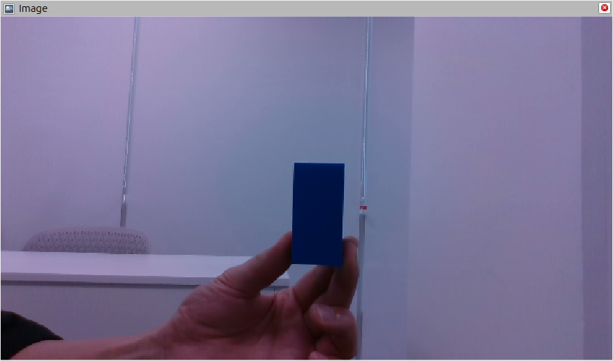
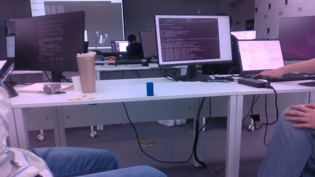
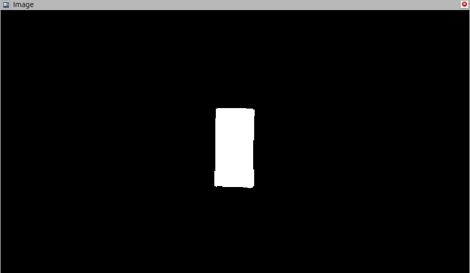
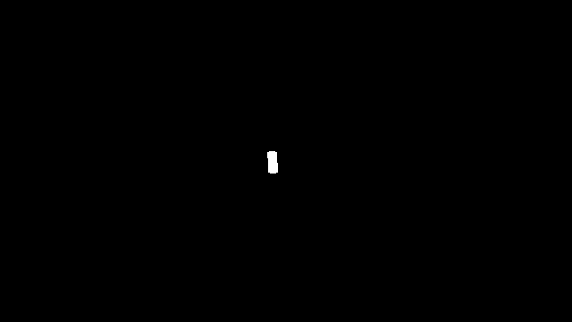
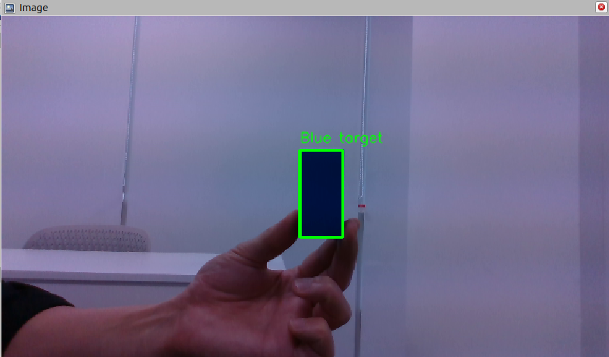
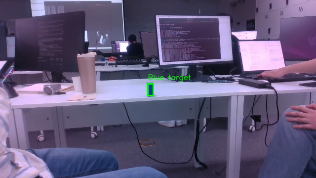
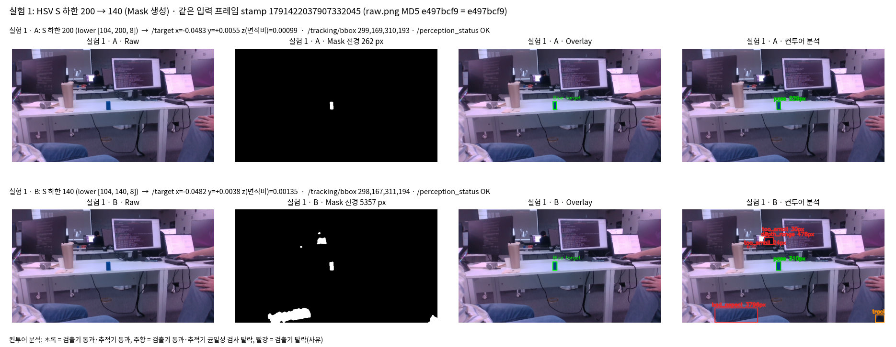
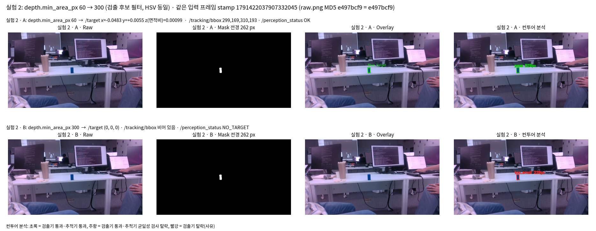

# 모듈 3. 설정값에 따른 Mask와 검출 결과 변화

## 1. 토픽 구성

실행 중 `ros2 topic list -t`, `ros2 topic info -v`로 확인.

| 자료             | 토픽 이름                   | 메시지 타입                           | 발행 노드          | 수신 도구           |
| -------------- | ----------------------- | -------------------------------- | -------------- | --------------- |
| Raw Image      | /camera/color/image_raw | sensor_msgs/msg/Image            | rosbag2_player | rviz2 Image     |
| Mask           | /tracking/mask          | sensor_msgs/msg/Image            | tracker_node   | rviz2 Image     |
| 검출 결과          | /target                 | geometry_msgs/msg/PointStamped   | tracker_node   | ros2 topic echo |
| 검출 결과          | /tracking/bbox          | geometry_msgs/msg/PolygonStamped | tracker_node   | ros2 topic echo |
| 검출 상태          | /perception_status      | std_msgs/msg/String              | tracker_node   | ros2 topic echo |
| 검출 결과(Overlay) | /tracking/image         | sensor_msgs/msg/Image            | rviz_node      | rviz2 Image     |


## 2. Raw Image
- 640×360, `encoding: rgb8`(bag에 녹화된 값). 트래커는 `cv_bridge`로 `bgr8`로 바꿔 읽는다.
- 장면: 책상 위 약 1m 거리에 파란 큐브(30×30×60 mm) 한 개 있다.



## 3. Mask
- 640×360. 255 = 전경(목표색으로 판정된 픽셀), 0 = 배경.
- detector.py: 생성 위치 color_mask(). 5×5 가우시안 블러, HSV 변환. 범위는 target.hsv_ranges = H 104~120, S 200~255, V 8~255. 색 세기(max−min) ≥ min_chroma 5인 픽셀만 남김. 5×5 타원 커널로 open 1회, close 2회.
- 후보 필터(면적·모양·뎁스)를 적용하기 전 단계의 출력. 그 뒤 findContours부터 후보 판정.
- 큐브는 아래쪽 그늘 부분까지 빠짐없이 남았고, 목표 외 영역은 없었다.
- tracker_node.py: detector_config 파라미터. 설정을 바꿀 때마다 노드를 새로 시작.



## 4. 검출 결과
| 토픽·필드                   | 의미                                                    | 단위   |
| ----------------------- | ----------------------------------------------------- | ---- |
| /target header          | 입력 영상 stamp, frame_id, camera_color_optical_frame     |      |
| /target point.x         | 정규화 가로 오차, 오른쪽이 +                                     | −1~1 |
| /target point.y         | 정규화 세로 오차, 아래가 +                                      | −1~1 |
| /target point.z         | 면적비 = 컨투어 면적 / (W×H). 0이면 미검출                         |      |
| /tracking/bbox polygon  | 점 2개 = 왼쪽 위·오른쪽 아래 픽셀 좌표. 빈 polygon = 미검출             | 픽셀   |
| /perception_status data | OK / NO_TARGET / CAMERA_STALL                         |      |
| /tracking/image         | Raw 위에 초록 상자와 "Blue target" 글자를 그린 이미지. 중심점은 그리지 않는다. |      |



- Overlay와 Raw 일치 확인: bbox (299,169)–(310,193)이 Raw의 큐브 위치와 겹친다.
- 미검출 표현: /target (0, 0, 0), bbox 빈 polygon, 상태 NO_TARGET이다.
- 결과 위치: tracker_node.py에서 cube_tracker.step()을 호출하고, /target, /tracking/bbox 상태를 발행한다.

처리 흐름
```
/camera/color/image_raw + /camera/aligned_depth_to_color/image_raw  (rosbag2_player)
   │ TimeSynchronizer → tracking_hz 타이머가 최신 처리 tracker_node.py
   ▼
cv_bridge rgb8→bgr8
tracker_node.py
   ▼
detector.detect()                                                      detector.py:
   ├ color_mask(): 블러 → HSV → inRange(hsv_ranges) → min_chroma → 열기·닫기
   │     └──────────────▶ /tracking/mask (mono8)                       tracker_node.py:
   ├ findContours → evaluate() 면적(min_area_px) → 모양 → 뎁스 거리·실제 크기
   └ select(): 통과 후보 중 면적 최대
   ▼
cube_tracker: 균일성 검사 → 대상 유지·선택   cube_tracker.py
   ▼
/target (PointStamped), /tracking/bbox (PolygonStamped), /perception_status (String)   tracker_node.py
   ▼
rviz_node: Raw + bbox → 상자 그리기 → /tracking/image (Overlay)      rviz_node.py, overlay.py
```

## 5. 설정값을 바꿔 변화 검증


- 해상도: 640×360(처리 해상도와 같음).
- 노드 파라미터: use_sim_time:=true, tracking_hz:=60, CSRT 추적 포함 기본 동작 그대로.
- 실험 1 — Mask 생성: (S 하한) A = 200, B = 140.
- 예상: 큐브는 S 248~255라 A·B 모두 남는다. 청바지·어두운 배경은 S가 대략 100~200이라 B에서 Mask에 새로 나타남. detector에서는 새 덩어리 중 크기·모양 검사를 통과하는 것이 생기면 '면적이 가장 큰 후보' 규칙 때문에 큐브 대신 선택될 수 있다. tracker_node는 균일성 검사(채도 중앙값 S ≥ 235 등)가 있어
  최종 /target은 큐브에 남을 가능성도 있다.
- 실험 2 — 뎁스가 있을 때 컨투어 최소 면적, 처리 해상도 640×360 픽셀
- A = 60, B = 300.
- 예상: Mask를 만든 뒤 컨투어마다 area < min_area_px이면 too_small로 버리는 조건.
  따라서 Mask는 A·B에서 같다. 증거 프레임의 큐브 컨투어는 약 229 px(1m)로 300보다 작아서
  B에서는 큐브가 탈락해 미검출(/target = 0,0,0, bbox 비어 있음, 상태 NO_TARGET).

| 실험         | 변경 변수                                      | A   | B   | 예상 변화 (실행 전)                                                                                                                          |
| ---------- | ------------------------------------------ | --- | --- | ------------------------------------------------------------------------------------------------------------------------------------- |
| 1 Mask 생성  | target.hsv_ranges.lower (S 하한, 0~255)      | 200 | 140 | 큐브(S 248~255)는 그대로 남고, S 140~200인 청바지·어두운 배경이 Mask에 새로 나타남. 검출기 단계에서 큰 배경 후보가 큐브 대신 선택될 수 있음. 최종 /target은 추적기 균일성 검사 때문에 큐브에 남을 수도 있음 |
| 2 검출 후보 필터 | depth.min_area_px (뎁스가 있을 때 컨투어 최소 면적, px) | 60  | 300 | Mask는 같음. 큐브 컨투어(약 229 px)가 300보다 작아 too_small로 탈락 → 미검출                                                                              |


### 실험 1 — S 하한 200 → 140



| 항목 (증거 프레임)                       | A: S ≥ 200                  | B: S ≥ 140                                                                                                              |
| --------------------------------- | --------------------------- | ----------------------------------------------------------------------------------------------------------------------- |
| Mask 전경 픽셀                        | 262                         | 5,357                                                                                                                   |
| Mask 덩어리                          | 큐브 1개                       | 6개: 큐브, 왼쪽 아래 청바지, 오른쪽 아래 청바지, 모니터 뒤 사람 머리, 작은 점 2개                                                                     |
| 검출기 판정 (candidates.json)          | 큐브 229 px                   | 큐브 310.5 px / 오른쪽 아래 청바지 417 px / 왼쪽 아래 청바지 3,795 px `bad_aspect` / 머리 475 px depth_range(3.9 m) / 점 24·30 px too_small |
| 검출기가 고른 후보 (면적 최대 규칙)             | 큐브                          | 청바지 (611,335, 29×25)                                                                                                    |
| 추적기 균일성 검사                        | 큐브 통과                       | 청바지 탈락 (S 중앙값 154 < 235, 큐브색 비율 0.818 < 0.90), 큐브 통과                                                                    |
| /target (x, y, z)                 | (−0.0483, +0.0055, 0.00099) | (−0.0482, +0.0038, 0.00135)                                                                                             |
| /tracking/bbox                    | (299,169)–(310,193)         | (298,167)–(311,194)                                                                                                     |
| /perception_status                | OK                          | OK                                                                                                                      |

- Mask 변화: inRange 조건 S ≥ lower의 하한이 내려가면서, S 140~199인 청바지(S 중앙값 154~155)와 어두운 머리(S 159)가 전경이 됐다.
  큐브는 S 중앙값 240 이상이라 A·B 모두 남았다. 다만 가장자리의 덜 진한 픽셀까지 포함돼 컨투어가 229 → 310.5 px로 커졌다.
- 검출 결과: 검출기만 보면 오른쪽 아래 청바지 조각이 크기 검사까지 통과했다(0.95 m, 5.0×5.8 cm).
  면적이 더 커서 select()가 큐브 대신 이것을 골랐다. B는 검출기 수준에서 오검출을 만든다.
- 최종 출력이 큐브에 남은 이유: tracker_node가 검출기 뒤에서 cube_tracker.uniform()을 적용.
  청바지는 채도가 낮고 듬성듬성해서 이 검사에서 걸렸다.
- 결론: A(200) 선택. B는 목표 검출에 이득이 없다. 반면 배경 전경 5,095 px와 큐브로 오인되는 후보를 추가해서, 뒷단 필터에 기대야 결과가 유지된다.

### 실험 2 — depth.min_area_px 60 → 300 (HSV는 S ≥ 200 고정)



| 항목 (증거 프레임)                       | A: 60                       | B: 300                         |
| --------------------------------- | --------------------------- | ------------------------------ |
| Mask 전경 픽셀                        | 262                         | 262 (mask.png 동일)              |
| 컨투어                               | 큐브 1개, 229 px, 1.02 m       | 같은 컨투어, 229 px                 |
| 판정                                | ok                          | too_small (area < min_area_px) |
| /target                           | (−0.0483, +0.0055, 0.00099) | (0, 0, 0)                      |
| /tracking/bbox                    | (299,169)–(310,193)         | 빈 polygon                      |
| /perception_status                | OK                          | NO_TARGET                      |
| Overlay                           | 큐브에 초록 상자                   | 상자 없음                          |
| 구간 전체 검출 (0~6.5 s, /target z > 0) | 114/114 프레임                 | 0/117 프레임                      |

- Mask는 변하지 않았다. 변화는 모두 컨투어 판정 단계에서 생겼다. min_area_px는 color_mask() 다음, evaluate()의 첫 조건(detector.py)에서만 쓰인다. Mask 생성과 후보 필터가 서로 다른 단계.
- 유일한 후보였던 큐브가 탈락했다. 큐브(229 px)가 300 미만이라 탈락해 통과 후보가 0개가 됐고, 미검출 표현이 발행.
- 컨투어 면적은 거리의 제곱에 반비례. 1m에서 229 px이면 300 px이 되는 거리는 약 0.89m다.
  B를 쓰면 약 0.89m보다 먼 큐브는 항상 놓친다.
- 결론: A(60) 선택. 이 프레임에서는 S ≥ 200 Mask에 잡음 덩어리가 없어서, 면적 하한을 올려도 줄일 오검출이 없었다. 목표만 잃었다.
- 한계: 잡음 덩어리가 많은 입력에서 60과 더 높은 값 사이의 이득은 확인하지 않았다.


선택값과 결론

| 변수                    | 선택  | 이유                                                                                 |
| --------------------- | --- | ---------------------------------------------------------------------------------- |
| S 하한 hsv_ranges.lower | 200 | 140으로 낮추면 목표 검출은 그대로이고, 배경(청바지·머리) 5,095 px와 큐브로 오인되는 후보가 생긴다. 검출기 단독으로는 오검출이 선택된다 |
| depth.min_area_px     | 60  | 300으로 올리면 Mask는 같은데 1.02 m 큐브(229 px)가 탈락해 구간 전체 미검출(114 → 0)이 된다                  |

- 실험 1의 B는 Mask를 넓혀 오검출 후보를 늘렸고, 실험 2의 B는 판정을 엄격히 해 목표를 미검출로 만들었다. 오검출은 뒤 단계(균일성 검사)가 막아 최종 출력에는 나타나지 않았다. 반면 미검출은 뒤 단계가 복구할 수 없어 최종 출력이 바로 0이 됐다.
